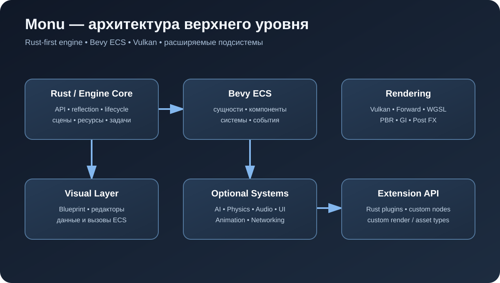
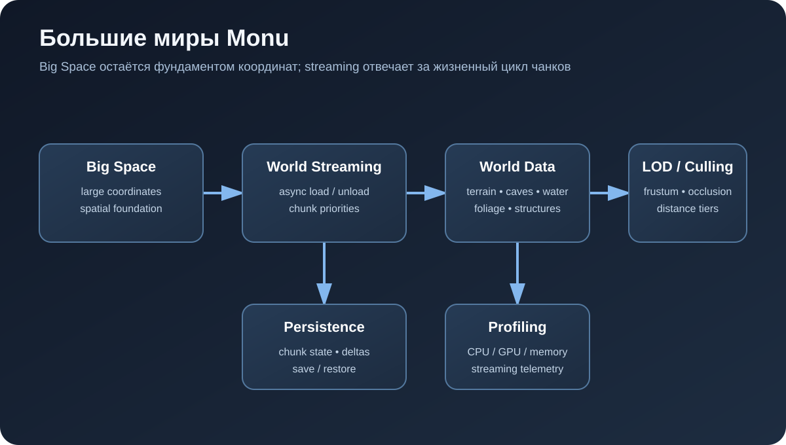
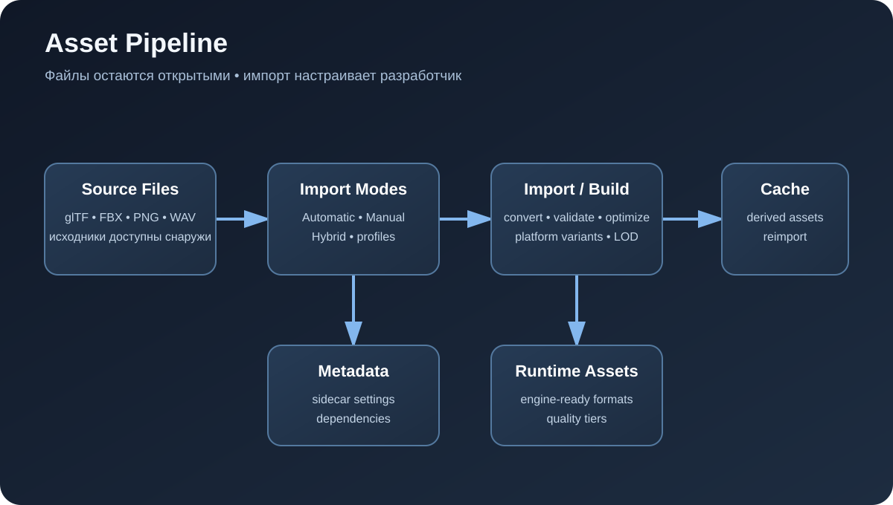

# Monu Architecture

## 1. Архитектурная схема

Monu строится вокруг Rust API и Bevy ECS. Визуальные инструменты редактора используют те же реальные типы, компоненты, события и системные интерфейсы, что и Rust-код.

### Основные слои

1. **Engine Core** — жизненный цикл приложения, сцены, ресурсы, конфигурация, задачи и общие API.
2. **ECS Layer** — интеграция с Bevy ECS, регистрация компонентов, систем, событий и пользовательских типов.
3. **Rendering** — Vulkan, Forward Rendering, материалы, WGSL, освещение и постобработка.
4. **Asset Layer** — Asset Manager, импорт, метаданные, зависимости, кэш и варианты ресурсов.
5. **Visual Layer** — Blueprint и визуальные редакторы поверх реальных API движка.
6. **Optional Systems** — игровые подсистемы, подключаемые по необходимости.
7. **Extension API** — Rust-плагины, пользовательские узлы, типы ресурсов, панели и инструменты.

## 2. Rust, ECS и Blueprint

- Rust — основной и полноценный путь программирования.
- Blueprint — визуальный способ вызывать и связывать реальные функции, события и ECS-системы.
- Не строить интерпретатор, который эмулирует Rust.
- Поддержать пользовательские ECS-компоненты и динамические типы через Reflection/регистрацию типов.
- Поддержать пользовательские Struct и Enum, включая вложенные Struct.
- Blueprint Struct могут использоваться в компонентах, переменных, функциях и Actor Blueprint.
- Предусмотреть Blueprint inheritance и возможность привязать пользовательскую Rust-реализацию к базовому Blueprint-классу.
- Поддержать пользовательские функции с входами/выходами, повторное использование графов и макросы.
- События: lifecycle, gameplay, input, custom events и ECS events.
- Пользовательские системы должны иметь возможность расширять или заменять стандартные.

Интерфейсы как отдельная обязательная система сейчас не требуются: использовать Rust traits, компоненты и ECS-механизмы.

## 3. Rendering

- Vulkan как целевой графический API.
- Forward Rendering как основной renderer.
- PBR.
- MSAA, прозрачность и оптимизация большого количества источников света.
- GI: предусмотреть выбор Baked, Real-time, Hybrid или No GI; конкретную технологию выбрать отдельно после прототипирования.
- Material Editor: node-based граф, PBR-параметры, текстуры, маски, процедурные материалы, instances, preview и собственные WGSL shaders.
- Shader Manager: компиляция WGSL, кэширование, горячая перезагрузка, диагностика ошибок и варианты шейдеров.
- Post Processing: Bloom, Motion Blur, Depth of Field, Color Grading, SSR, Volumetric Fog и дополнительные эффекты; набор должен учитывать возможности Forward Rendering.
- VFX: GPU particles, модульная система эффектов, decals, события и пользовательские WGSL shaders.
- Погода и атмосфера: день/ночь, дождь, снег, грозы, туман, облака, ветер и сезонные изменения; связь с материалами, растительностью, водой и освещением.

Deferred Rendering не входит в текущий базовый план.

## 4. Большие миры

- Существующий Big Space остаётся фундаментом для больших координат и пространств.
- Не создавать вторую систему, дублирующую Big Space.
- World Streaming располагается поверх него и отвечает за асинхронную загрузку/выгрузку чанков и их жизненный цикл.
- Приоритеты загрузки учитывают расстояние, направление движения, видимость и важность.
- LOD для геометрии, растительности и других объектов.
- Frustum Culling и Occlusion Culling.
- Динамическое управление качеством при изменении нагрузки.
- Профилирование streaming и загрузки.
- Сохранение состояния отдельных чанков и изменений мира.

## 5. Мир, Terrain и окружение

### Terrain

- Terrain Editor уже начат пользователем; текущее состояние кода требуется проверить отдельно.
- Ручное формирование рельефа кистями и трафаретами.
- Импорт Heightmap, созданных во внешних редакторах.
- Импорт дополнительных карт: Splatmap, Normal, Slope, Wetness, Foliage Mask, Water Mask и пользовательские карты.
- Редактирование масок в Monu и расширение через Rust.
- Процедурная генерация рельефа — дополнительный инструмент, а не обязательный способ создания мира.

### Вода

Реки, озёра и моря; редактирование русел и берегов; ширина, глубина и течение; волны и прибой; подводный рельеф; водопады; плавучесть; подводное освещение и туман; интеграция с погодой и навигацией.

### Пещеры и подземелья

Полноценная 3D-геометрия, а не только heightmap: своды, нависающие скалы, шахты, тоннели, подземные озёра, несколько уровней и соединения с поверхностью. Предусмотреть возможность разрушения частей окружения.

### Растительность

Процедурное и ручное размещение, биомы, ветер, LOD/culling, пользовательские ассеты. Рост растений может быть добавлен позднее.

## 6. Генераторы

Генераторы специализированы по задачам и используют общий API:

- Architecture Generator — здания, дома, замки, башни.
- Interior Generator — комнаты, коридоры, двери, окна, лестницы, мебель и свет.
- Road & Infrastructure Generator — дороги, тропы, мосты, перекрёстки и тоннели.
- Nature & Environment Generator — деревья, кусты, трава, камни, скалы, корни и природный декор.
- Cave Generator — пещерные пространства.
- City Generator — районы, кварталы, улицы, площади и размещение зданий.
- Terrain Generator — дополнительная процедурная генерация рельефа.

**Generator Graph**: визуальная логика генерации, условия, циклы, трансформации, random seed, кривые, поверхности, точки, параметры, переиспользуемые графы и пользовательские Rust-узлы. Исполнение должно быть эффективным, без тяжёлой интерпретации каждого узла в runtime.

Для Road Generator особенно важны точечная настройка вдоль кривой, редактирование контрольных точек и возможность зафиксировать результат. По возможности сохранять исходную кривую и параметры до явного bake/удаления процедурных данных.

Результаты генераторов можно вручную редактировать и bake в обычную геометрию.

## 7. Physics, movement и destruction

- Выбор физической библиотеки и её интеграции с Bevy ECS требует отдельного технического прототипа; конкретная библиотека пока не утверждена.
- Поддержать заранее подготовленные фрагменты, runtime fracturing и гибридное разрушение.
- Сохранять состояние разрушенных объектов в Save System.
- Physics-Based Animation: ragdoll, динамическое равновесие и физические реакции.
- Movement & Traversal: верховая езда, полёт, плавание/ныряние и в перспективе транспорт.
- Готовые реализации должны быть настраиваемыми и заменяемыми через Rust.

## 8. Gameplay systems

Предусмотреть опциональные или включаемые по необходимости модули:

- AI: Behavior Trees, State Machines, Decision System; distance tiers и редкое обновление удалённых NPC.
- Navigation: NavMesh, наземная/воздушная/водная навигация, пользовательские реализации и потоковые данные.
- Crowd System: массовое перемещение, потоки, избегание столкновений, расписания и AI LOD.
- Inventory/Items: предметы, экипировка, stacking, loot, containers, crafting и визуальный редактор данных.
- Dialogue: граф диалога, условия, переменные, выборы, события, локализация и интеграция с квестами.
- Quest System — опциональная.
- Building System — опциональная система строительства во время игры.
- Interaction presets: pickup, двери, сундуки, рычаги, осмотр, NPC interaction и context actions.
- Audio: spatial 3D audio, events, dynamic music, reverb/occlusion, mixer и streaming.
- Cinematic: Sequencer, Timeline, camera rig, blending, event/animation/audio tracks.
- UI: visual editor, widgets, HUD, layout, animations, data binding и custom widgets.
- Localization: единая система для UI, диалогов, субтитров и аудио; UTF-8, RTL, plural rules, font fallback и импорт/экспорт.

## 9. Save System

World Save, Entity Save, Terrain Save, Destruction Save, Player Save, per-chunk Streaming Save, Auto Save, delta changes и versioned save format.

## 10. Networking

Networking Framework заложить архитектурно, но выключать по умолчанию:

- Server / Client / Host.
- ECS replication, RPC и network events.
- Authoritative server.
- Physics synchronization.
- Interpolation и lag compensation.
- Явный выбор компонентов для репликации; не реплицировать автоматически все ECS-компоненты.

Отдельная Anti-Cheat система отложена.

## 11. Performance и диагностика

- Profiler для FPS/frame time, CPU, GPU, memory, ECS, rendering, physics, AI, streaming и network при включённой сети.
- Frame Debugger, Performance Timeline, bottleneck detection и benchmark mode.
- Профилирование как в редакторе, так и в собранной игре.
- Debugger: Rust debugging, Blueprint stepping и значения узлов, ECS Inspector, Event Debugger и Error Console.
- Testing Framework предусмотреть как отдельный будущий инструмент: Rust unit/integration, ECS/system, Blueprint graph и simulation tests, headless CI.

## 12. Asset Pipeline

Подробности — в разделе Asset Pipeline документа [README](README.md) и в решениях [DECISIONS](DECISIONS.md). Ключевые требования: Automatic / Manual / Hybrid режимы, профили импорта, кэш, reimport, платформенные варианты, уровни качества, LOD и открытые исходные файлы.
