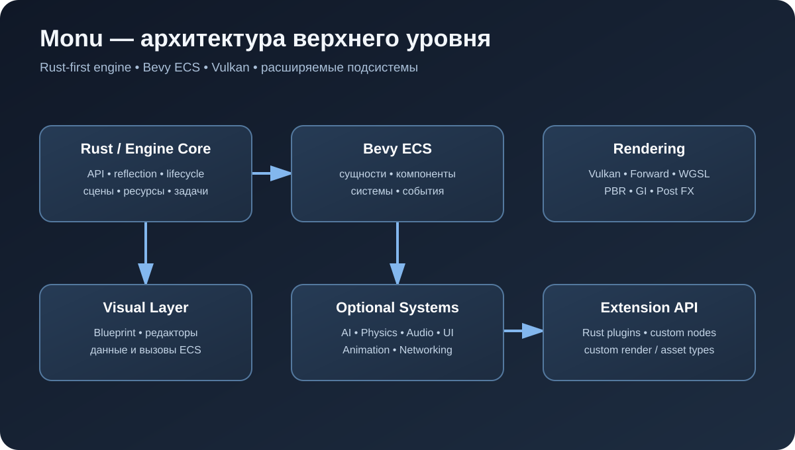

# Monu Editor

## 1. Общая концепция

Редактор модульный, настраиваемый и расширяемый. Он не должен быть единственным способом работы с движком: все важные функции доступны через Rust API.

## 2. Рабочее пространство

- Dockable panels: перемещение, закрепление, объединение во вкладки.
- Несколько рабочих пространств: Terrain, Animation, Materials, Blueprint, UI и другие.
- Сохранение пользовательских раскладок.
- Возможность открыть несколько сцен и окон редактора одновременно.
- Настраиваемые горячие клавиши.
- Контекстные меню и панели инструментов.

## 3. Blueprint Editor

- Графы событий и функций.
- Пользовательские функции с входами/выходами.
- Макросы и повторно используемые группы узлов.
- Struct и Enum.
- События lifecycle, gameplay, input и ECS.
- Blueprint inheritance.
- Привязка Rust-типов и реализаций.
- Debug stepping, значения узлов и диагностика ошибок.
- Пользовательские узлы через Rust и плагины.

Blueprint — визуальный слой над реальными механизмами движка, а не отдельная эмулируемая виртуальная машина Rust.

## 4. Редакторы и инструменты

Предусмотреть специализированные редакторы для:

- Terrain и масок.
- Материалов и шейдеров.
- Blueprint.
- Animation и IK tools.
- AI graphs и navigation.
- Dialogue и Quest.
- UI и localization.
- VFX и Audio.
- Sequencer / Cinematic.
- Процедурных генераторов и Generator Graph.

Полноценное моделирование мешей остаётся во внешних инструментах (например, Blender). В Monu допустимы специализированные архитектурные и процедурные генераторы геометрии.

## 5. Asset Manager

Asset Manager работает поверх обычной файловой системы:

- Папки и файлы остаются обычными файлами проекта.
- Автоматическое обнаружение новых и изменённых файлов.
- Импорт и настройки в sidecar metadata.
- Поиск, фильтры и зависимости.
- Drag-and-drop ресурсов в сцену и Blueprint.
- Исходные файлы доступны внешним редакторам.

## 6. Plugin System

Плагины могут расширять как UI, так и движок:

- панели и окна;
- инструменты и редакторы;
- пользовательские типы ассетов;
- ECS-компоненты и системы;
- Blueprint nodes;
- интеграции сторонних библиотек;
- Rust API для Editor и Engine.

Marketplace не нужен. Достаточно ручной установки и управления совместимостью, включением и отключением плагинов.

## 7. Project Manager и удобство работы

- Создание и открытие проектов.
- Recent projects.
- Шаблоны игр и пользовательские шаблоны.
- Настройки проекта и целевые платформы.
- Управление модулями и проверка зависимостей.
- Presets System: готовые и пользовательские пресеты, переносимые между проектами.

## 8. Документация и диагностика

- Встроенная справка Rust API, ECS компонентов и Blueprint nodes.
- Примеры и tutorials.
- Поиск по документации.
- По возможности генерация из исходников.
- Rust debugger, Blueprint debugger, ECS Inspector, Event Debugger и Error Console.
- Profiler и Frame Debugger.

## 9. Что не входит в текущую цель

- Полноценный Mesh Editor.
- Встроенный Git-клиент.
- Marketplace плагинов.
- Специальная VR/AR-инфраструктура.
- Modding Framework — отложен.
- Engine Version Manager — отдельный менеджер не нужен; предпочтительны стабильные API/форматы и миграции при необходимости.
