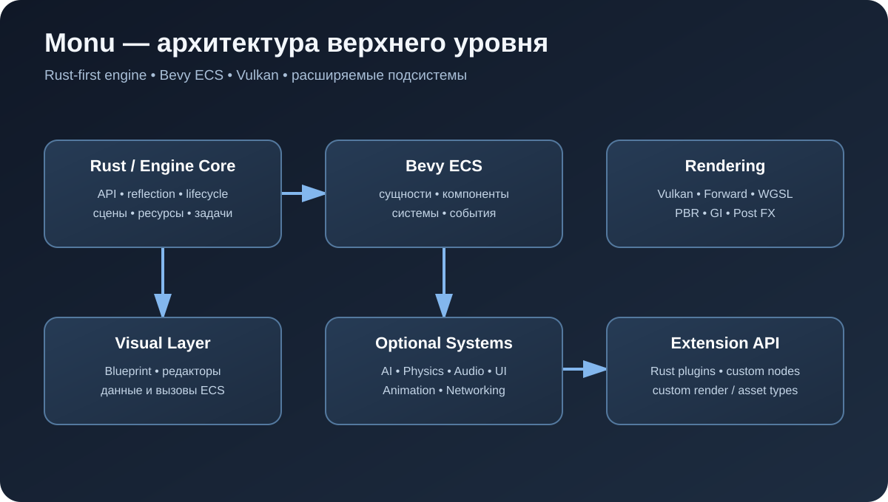

# Monu Engine — план и концепция

> Рабочая спецификация по итогам обсуждения архитектуры Monu. Это планируемые требования и принципы, а не утверждение, что все перечисленные функции уже реализованы в репозитории.

## Краткое описание

**Monu** — Rust-first игровой движок с Bevy ECS в основе. Rust остаётся полноценным способом разработки и расширения движка. Визуальное программирование Blueprint предназначено для ускорения работы и доступности инструментов, но не является эмуляцией Rust и не должно ограничивать возможности разработчика.

Основные ориентиры:

- Rust — язык движка, систем и расширений.
- Bevy ECS — фундамент сущностей, компонентов и систем.
- Vulkan — целевой графический API.
- Forward Rendering — основной путь рендеринга на старте.
- WGSL — пользовательские шейдеры.
- Обычная файловая система — основа хранения ресурсов проекта.
- Готовые подсистемы Monu можно включать, расширять или заменять собственными реализациями на Rust.

## Документы

- [Архитектура движка](ARCHITECTURE.md)
- [Редактор и Blueprint](EDITOR.md)
- [План разработки](ROADMAP.md)
- [Принятые решения и ограничения](DECISIONS.md)

## Статус сведений о коде

Документы отражают решения, принятые в обсуждении. Реальное состояние кода, модулей и Terrain Editor необходимо отдельно сверить с текущей веткой репозитория. Наличие функции в этом плане не означает, что она уже реализована.

## Ключевой принцип

Сначала надёжный и производительный фундамент, затем основные инструменты разработки игр, после этого — сложные и специализированные системы. Архитектурные точки расширения предусматриваются заранее, но необязательные подсистемы не должны усложнять базовый runtime.
