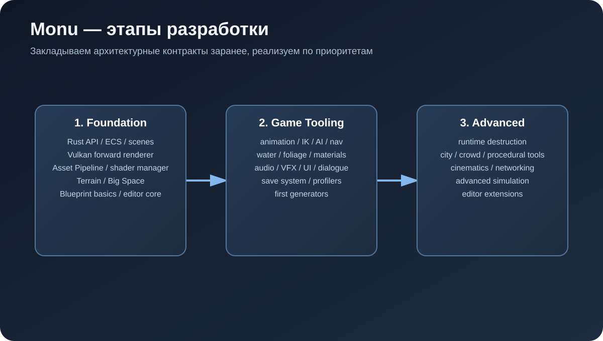

# Monu Roadmap

## Принцип планирования

Этапы определяют порядок приоритетов, а не обещают сроки. Архитектурные контракты будущих систем можно предусматривать заранее, но реализацию следует вести постепенно. До назначения задач необходимо сверить план с текущим состоянием репозитория.

## Этап 0. Аудит существующего состояния

Перед планированием спринтов:

1. Зафиксировать текущую ветку и структуру crates/modules.
2. Составить инвентаризацию уже работающих подсистем.
3. Отдельно пометить: реализовано, начато, прототип, запланировано.
4. Для существующего Terrain Editor описать текущие возможности и пробелы.
5. Проверить интеграцию Bevy ECS, Big Space и renderer.
6. Выявить архитектурные зависимости и технические риски.

## Этап 1. Фундамент

Цель: минимальный, устойчивый вертикальный срез движка.

Приоритетные направления:

- Engine Core и Rust API.
- ECS integration и регистрация пользовательских типов.
- Сцены и базовый lifecycle.
- Vulkan renderer с Forward Rendering.
- Базовые PBR материалы и WGSL pipeline.
- Shader Manager и диагностика.
- Asset Manager и Asset Pipeline.
- Import modes: Automatic / Manual / Hybrid.
- Asset cache, reimport и platform variants.
- Big Space integration и основы World Streaming.
- Terrain Editor и импорт Heightmap.
- Базовая физика после выбора и проверки библиотеки.
- Blueprint foundation, работающий с реальными ECS/Rust механизмами.
- Основы модульного редактора и Project Manager.
- Error Console и начальная диагностика.

Критерий готовности этапа: разработчик может создать проект, импортировать ресурсы, собрать сцену, настроить материалы, добавить Rust/ECS поведение и запустить игру из редактора.

## Этап 2. Основные игровые инструменты

- Skeletal Animation, Animation State Machine, Blend Spaces, IK.
- Procedural Animation и подготовка Facial Animation.
- AI: Behavior Trees, State Machine, Decision System.
- Navigation и NavMesh.
- Foliage, вода и расширение Terrain.
- Audio и VFX.
- UI Editor и Localization.
- Dialogue и базовая Quest System.
- Save System.
- Profiler, Frame Debugger и Blueprint Debugger.
- Первые генераторы: Architecture, Interior, Road, Nature, Cave.
- Presets и Plugin API.
- Crowd System и Building System — как подключаемые модули.

Критерий готовности этапа: на движке можно собрать полноценный игровой прототип с окружением, персонажами, интерфейсом, звуком, сохранением и базовым AI.

## Этап 3. Продвинутые возможности

- Runtime fracturing и гибридное разрушение.
- Physics-Based Animation.
- City Generator и продвинутый Generator Graph.
- Crowd simulation и сложные NPC workflows.
- Sequencer и расширенная Cinematic System.
- Networking Framework.
- Продвинутый World Streaming и динамическое управление качеством.
- Расширенные инструменты редактора и документации.
- Более сложные симуляции и интеграции.

Критерий готовности этапа: движок поддерживает крупные и сложные проекты с масштабным миром, расширенными игровыми системами и сетевым режимом.

## Сквозные требования

На каждом этапе:

- Не допускать неоправданных накладных расходов от визуальных инструментов.
- Сохранять возможность реализации через Rust.
- Проверять совместимость с ECS и streaming.
- Документировать публичные API и форматы.
- Предусматривать миграции при неизбежных изменениях форматов.
- Профилировать критические участки.
- Не включать необязательные подсистемы в базовый runtime без необходимости.

## Предлагаемые критерии приоритизации задач

Для каждой задачи указывать:

- пользовательскую ценность;
- блокируемые зависимости;
- стоимость реализации;
- риск для архитектуры;
- влияние на runtime performance;
- критерии приёмки;
- тесты и демонстрационную сцену.
